# Test Summary Yield / Bin Trend / SBL Tool

A single HTML file that reads semiconductor **test summary CSV** files and automatically shows:

- **First Yield** and **Final Yield** for every lot (first pass `P` + retests `O`)
- **Bin trends** (per lot / day / week / month / quarter / year), Pareto and heatmap
- **Yield / bin trends by Product or Test Center** (one line per product or test center)
- **Tester / Loadboard / Test Center performance**, and a Tester × Loadboard matrix
- **SBL (Statistical Bin Limit) check**: which lots are on **HOLD** and which bin broke the limit

It runs fully offline in the browser (no install, no server, no internet).

> **This README is also built into the tool.** Click **📖 說明 README** in the toolbar to read it, with the flowcharts drawn in the page (works offline). Use **🌐 EN / 中文** to switch the whole tool between Chinese and English, and **🌙 / ☀️** for dark / light mode.

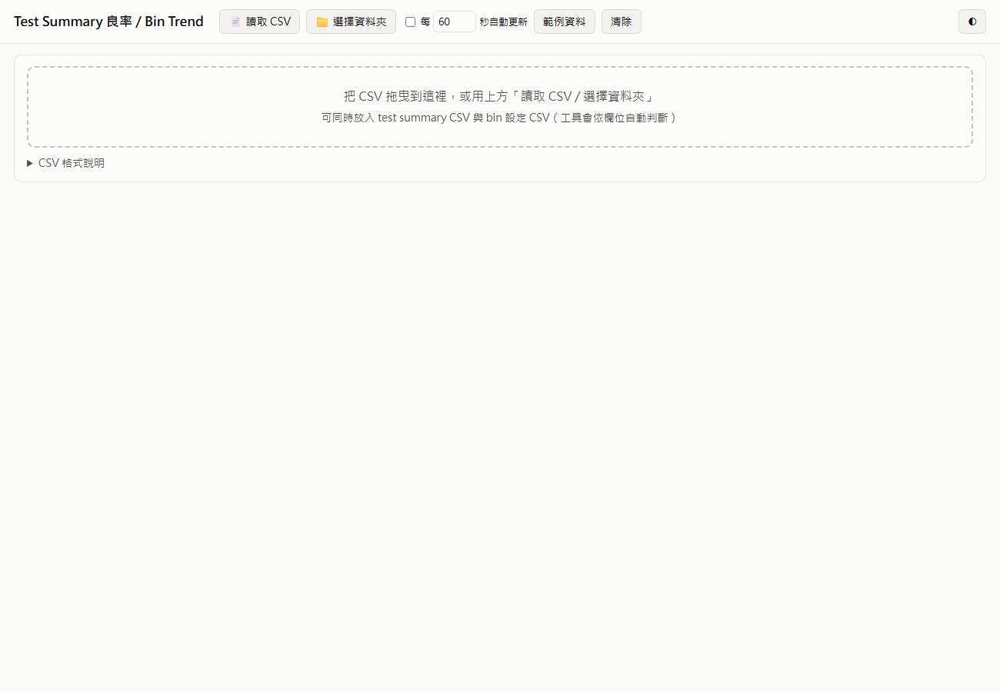

---

## Contents

1. [Quick start](#1-quick-start)
2. [Files](#2-files)
3. [CSV formats](#3-csv-formats)
4. [How it works (flowcharts)](#4-how-it-works-flowcharts)
5. [Screens](#5-screens)
6. [Big data](#6-big-data)
7. [FAQ](#7-faq)

---

## 1. Quick start

1. Open `test_summary_trend.html` in **Chrome or Edge**.
2. Load data, choosing one of these ways:
   - **📄 讀取 CSV**: pick one or more CSV files.
   - **📁 選擇資料夾**: pick a folder; every CSV in it is read. Next time you open the page it reconnects automatically. Tick **每 N 秒自動更新** to re-read the folder when files change.
   - Drag & drop CSV files onto the page.
3. You can load the test summary, bin config and SBL limit files **together**. The tool detects each file's type from its columns.
4. Click **範例資料** to see a demo with sample data.
5. Click **📖 說明 README** for this help page and the flowcharts. **🌙 / ☀️** switches dark / light mode; **🌐 EN / 中文** switches the whole tool (and this help) between Chinese and English.

> Bin config and SBL limits are remembered in the browser until you replace or clear them.

---

## 2. Files

| File | Purpose |
|---|---|
| `test_summary_trend.html` | The tool, with this README and the flowcharts built in (📖 說明 README) |
| `sample_test_summary.csv` | Sample test summary: 162 lots at 3 test centers, P + O, multiple retests |
| `sample_bin_config.csv` | Sample bin config: HB1 = pass; HB8 / HB9 / HB11 not retestable |
| `sample_sbl_limit.csv` | Sample SBL limits |
| `flowchart.html` | Optional: the Mermaid version of the flowcharts (needs internet). The same diagrams are built into the tool |
| `docs/images/` | Screenshots used in this README |

---

## 3. CSV formats

Column names are **not case-sensitive**, the column order doesn't matter, and the file can be UTF-8 or Big5 (Excel).

### 3.1 Test summary CSV

```csv
Date,Lot,Product,Stage,TestCenter,TestMode,Tester,Loadboard,Input,HB1,HB2,HB3,...,HBn
2026/09/01 02:00,LA02601,ABC123,FT1,Kaohsiung,P,T02,LB-C1,3864,3747,16,13,...
2026/09/01 05:00,LA02601,ABC123,FT1,Kaohsiung,O,T02,LB-C1,96,56,5,3,...
```

| Column | Meaning | Accepted names |
|---|---|---|
| Date | Test date (time optional) | `Date`, `Test Date`, `Start Time`, `日期` … |
| Lot | Lot ID | `Lot`, `Lot ID`, `LotNo` … |
| Product | Product / device | `Product`, `Device`, `Part` … |
| Stage | Test stage | `Stage`, `Step` … |
| Test Center | Test site / test house (optional). Used by the filter, **Compare by** and Test Center performance | `Test Center`, `TestCenter`, `Test Site`, `Site`, `Location`, `Subcon`, `OSAT` … |
| TestMode | `P` = first test, `O` = retest (`O1`, `O2` … allowed) | `TestMode`, `Mode`, `Flow` |
| Tester | Tester ID | `Tester`, `ATE` … |
| Loadboard | Loadboard ID | `Loadboard`, `LB`, `DIB` … |
| Input | Optional; if missing, the sum of the bins is used | `Input`, `Qty`, `Total` |
| HB*n* | Hard-bin counts | `HB1`, `HBIN1`, `BIN1`, `HB_01` |

Supported date formats: `2026/09/01`, `2026-09-01 14:30`, `20260901`, `09/01/2026 2:30 PM`, `2026/9/1 下午 02:30`, and Excel serial numbers.

### 3.2 Bin config CSV (good bins / non-retestable bins)

```csv
Bin,Description,Retestable,Pass
HB1,Pass,Y,Y
HB8,Open/Short,N,N
HB9,Continuity,N,N
HB11,Burn/Damage,N,N
```

- `Retestable = N` means the bin is **not retestable**. Units in it are a final fail and are never retested.
- `Pass = Y` marks a good bin (default: HB1).
- A file with only a `Bin` column means "every listed bin is non-retestable".
- You can also edit these settings directly in the page (**Bin 設定**).

### 3.3 SBL limit CSV

```csv
Product,Stage,Bin,Basis,Max_Pct,Max_Qty,Min_Pct,Remark
*,*,HB5,P,1.40,,,Scan
*,*,HB8,Final,0.50,,,Open/Short
*,*,HB11,Final,0.30,8,,limit in % and pcs
XYZ789,*,HB4,P,1.10,,,stricter for XYZ789
*,*,FIRST_YIELD,,,,94.5,
ABC123,FT2,FINAL_YIELD,,,,97.0,
```

| Column | Meaning |
|---|---|
| Product / Stage | `*` or blank = applies to all |
| Bin | `HB5` etc., or `FIRST_YIELD` / `FINAL_YIELD` |
| Basis | `P` = first-pass count (default); `Final` = count after retests |
| Max_Pct | Upper limit in % of P Input (`1.4` = 1.4%) |
| Max_Qty | Upper limit in pieces (can be used together with Max_Pct) |
| Min_Pct | Lower limit, for yield items (%) |

If several rows match the same lot and bin, the **most specific row wins**: Product+Stage › Product › Stage › `*`.

---

## 4. How it works (flowcharts)

> **Easiest:** open the tool and click **📖 說明 README** → section 4. The diagrams are drawn in the page, offline, and follow dark / light mode and the language setting.
> The [Mermaid](https://mermaid.js.org/) versions below render on GitHub / GitLab and in VS Code (with a Mermaid preview extension).

### 4.1 Overall data flow

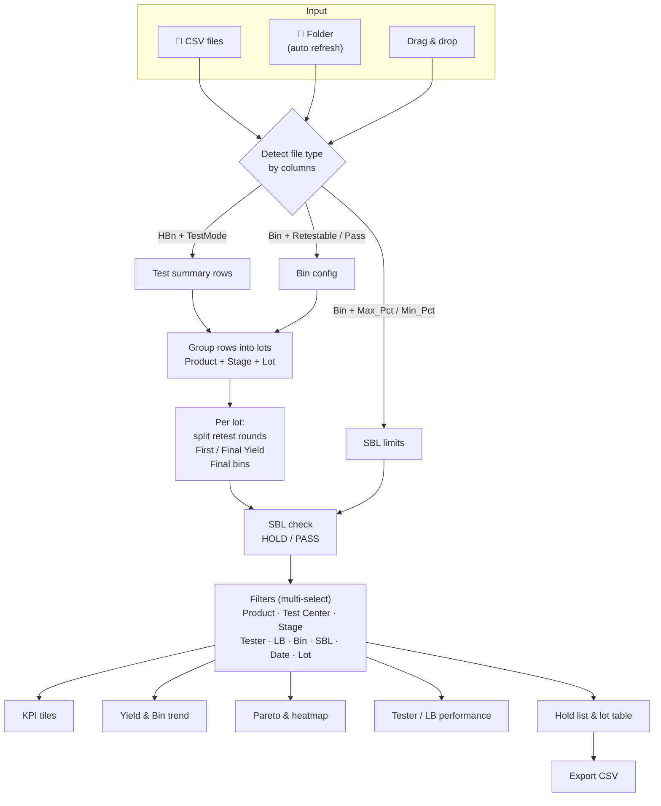

### 4.2 Yield calculation for one lot

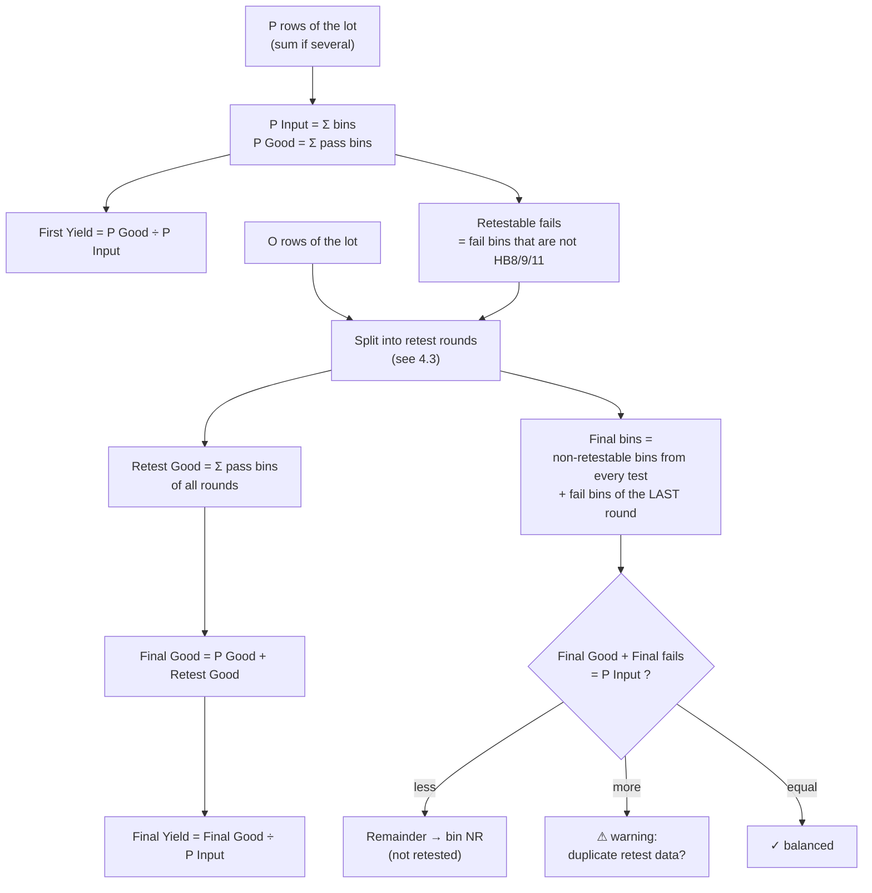

**Worked example** (lot LA02601 in the sample):

| Step | Input | Good | Retestable fails | Non-retestable (HB8/9/11) |
|---|---:|---:|---:|---:|
| P | 3,864 | 3,747 | 96 | 21 |
| O round 1 | 96 | 56 | 40 | 0 |
| O round 2 | 40 | 11 | **29** | 0 |
| **Result** | | **3,814** | | |

- First Yield = 3,747 ÷ 3,864 = **96.97%**
- Final Yield = 3,814 ÷ 3,864 = **98.71%**
- Final fails = 21 (non-retestable) + 29 (last round) = 50 → 3,814 + 50 = 3,864 ✓

### 4.3 Splitting retest (O) rows into rounds

The rule: **each retest round's Input = the previous round's retestable fails**. Because of that, rounds are found correctly even when the CSV has only a date (no time), when the rows are out of order, or when one round was split across two testers.

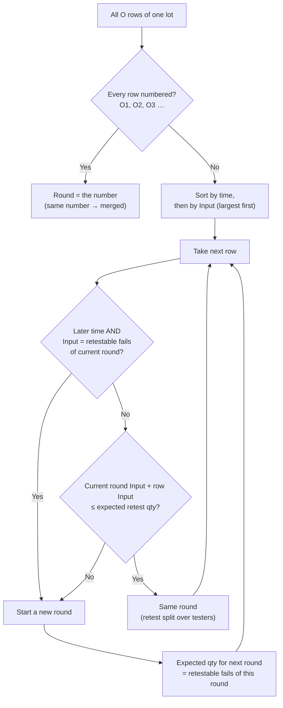

### 4.4 SBL HOLD decision

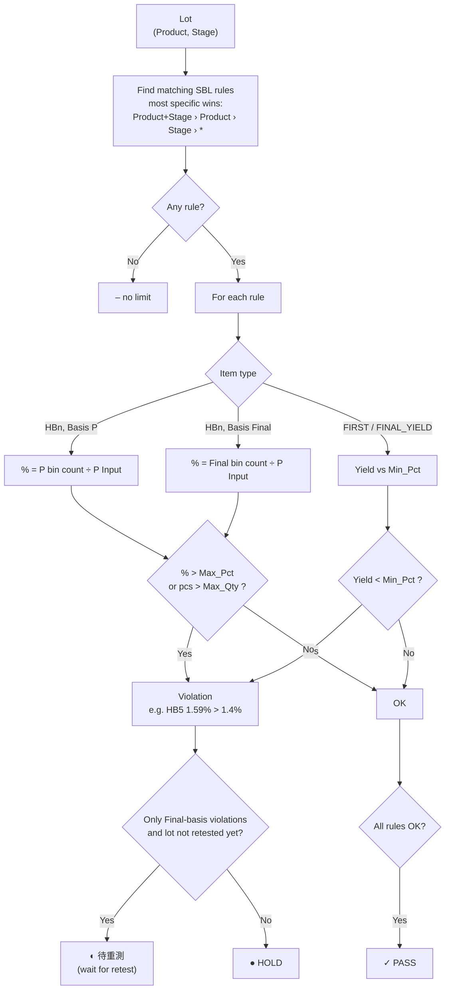

### 4.5 Folder auto-refresh

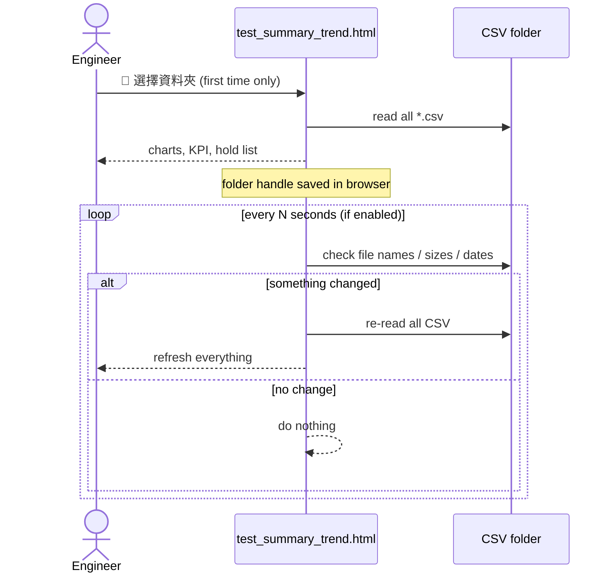

---

## 5. Screens

### Filters and KPI
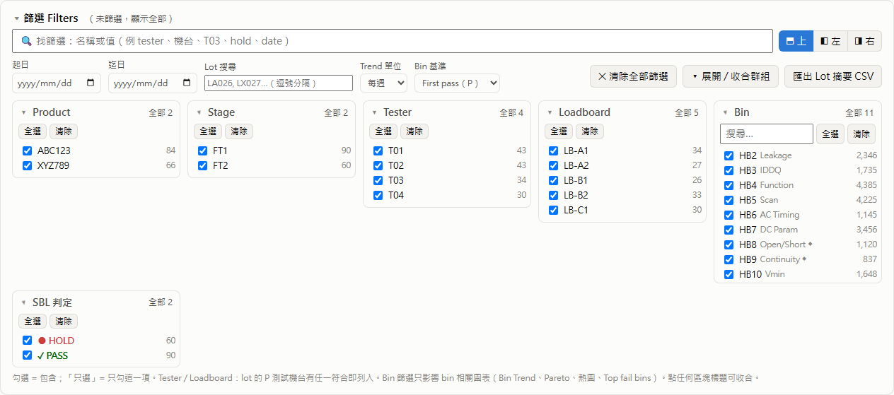
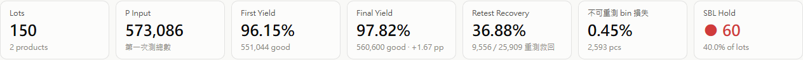

**Multi-select filters.** Each group can be collapsed (click its title):

| Group | Filters | Notes |
|---|---|---|
| Product / Stage | lots | |
| Test Center | lots | Test center of the lot's P test |
| Tester / Loadboard | lots | A lot is included if **any** of its P testers / loadboards is selected |
| Bin | bin charts only | Bin trend, Pareto, heatmap, Top fail bins. Lot counts and yields are **not** changed |
| SBL 判定 | lots | HOLD / 待重測 / PASS / no limit |
| 起日 / 迄日 | lots | Date of the P test |
| Lot 搜尋 | lots | Part of a lot ID; several, comma-separated (e.g. `LX027, LA0260`) |

- In each group: tick / untick items, **只選** (shown on hover) keeps only that item, and **全選 / 清除** select all / none. Groups with more than 8 items have a search box.
- The number next to each item = lots (for Bin: P fail pieces).
- Active filters appear as chips next to the **篩選 Filters** title. Click **✕** on a chip to remove that filter, or **✕ 清除全部篩選** to remove all.

**Filter position: top, left or right.** Use **⬒ 上 / ◧ 左 / ◨ 右** at the top of the filter panel.
- **Left / Right:** the filters become a sidebar that stays in place while you scroll the charts. Collapsing the sidebar (click **篩選 Filters**) shrinks it to a narrow strip, so the charts use the full width.
- The browser remembers the position. On narrow screens (< 900 px) the filters always go back to the top.

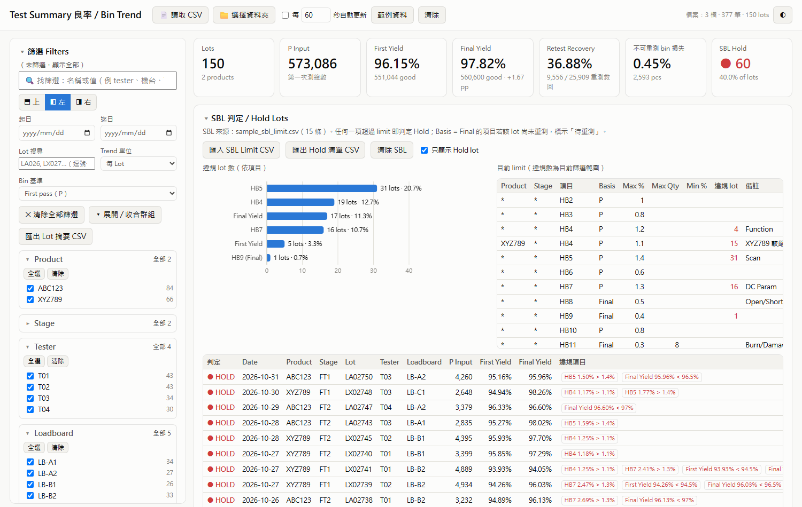

**Find a filter by name.** Type in **🔍 找篩選**. Press `/` anywhere to jump to it, and `Esc` to clear it.
- **Filter names**, in English or Chinese: `tester` / `機台`, `loadboard` / `LB`, `product` / `產品`, `site` / `test center` / `測試廠`, `stage` / `站別`, `bin`, `sbl` / `hold`, `date` / `日期`, `lot`, `trend`, `basis`. Only the matching filters are shown, with all their values.
- **Filter values**, e.g. `T03`, `LB-B2`, `scan` (a bin description): the group containing the value opens and shows only the matching values, so you can tick them directly.
- Groups opened by the search close again when you clear it.

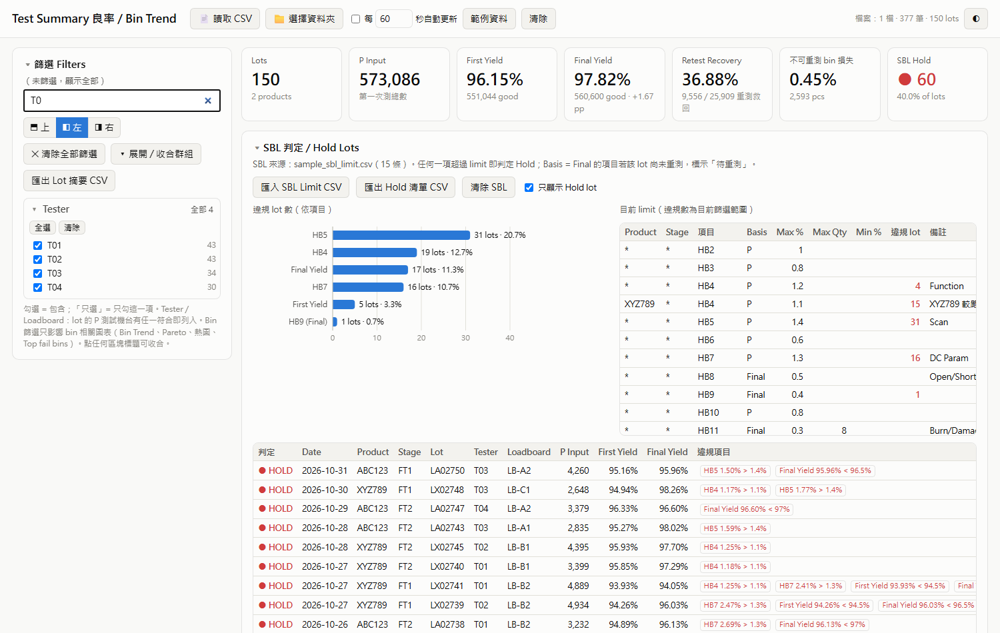

**Zoom.** Every chart (and every flowchart in the help page) has a square **⛶** button: one click opens it large, and **✕**, `Esc` or a click outside closes it.

**Collapsible sections.** Click any section title (▾) to collapse or expand it, including the whole filter panel. The browser remembers which sections are collapsed.

- **Bin 基準**: `First pass (P)` or `Final` (after retests). It affects the bin trend, Pareto and heatmap.
- **Trend 單位**: groups the Yield trend, Bin trend and heatmap by **lot / day / week / month / quarter / year**.
  - Week = ISO week (Monday–Sunday, e.g. `2026-W05`). Quarter = `2026-Q1` (Jan–Mar). Year = `2026`.
  - Each point is a weighted yield: Σ good ÷ Σ P Input of all lots in that period. A lot belongs to the period of its P test date.
  - With more than 1,000 lots it switches from per-lot to daily automatically.

### SBL / Hold lots
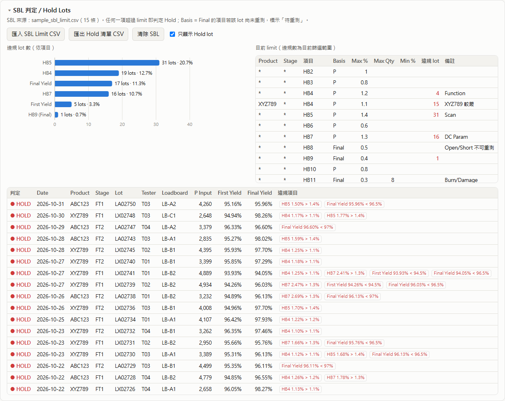

- **Left:** how many lots broke each limit.
- **Right:** the active limits, with how many lots broke each one.
- **Below:** the hold list with each violation.
- **匯出 Hold 清單 CSV** exports the hold list.

### Yield trend
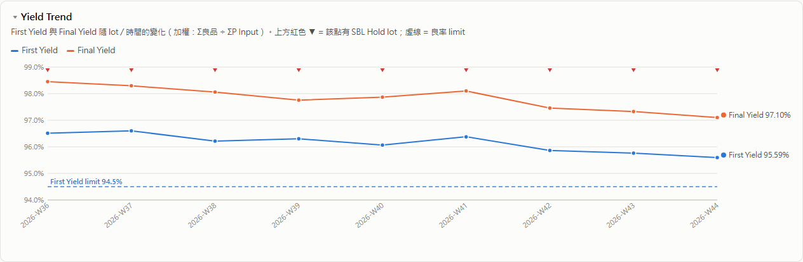
- **時間單位 / Time unit** above the chart: Lot / day / week / month / quarter / year, for this chart only (the filter panel's Trend unit sets all charts at once).
- **圖表 / Chart**: **Line** (weighted First / Final Yield), **Loss bars** (whole bar = First Yield loss; lower part = Final loss still failing, upper part = recovered by retest), or **Box plot** (spread of lot yields per period: box = Q1–Q3, thick line = median, whiskers = 1.5×IQR, circles = outlier lots). Box plots need a time unit, so choosing it from per-lot switches to weekly.
- **分組比較 / Compare by**: **None / Product / Test Center** draws one line (or one set of bars / boxes) per product or test center, for **First** or **Final** Yield (toggle next to it). Each product / test center keeps its colour (ranked by P Input), so filtering never repaints it; with more than 8, everything after the first 7 is merged into "Other". It needs a time unit, so choosing it from per-lot switches to weekly.
- Red ▼ at the top = this point contains a HOLD lot.
- Dashed lines = yield limits.
- Hover a point for details.

### Bin trend
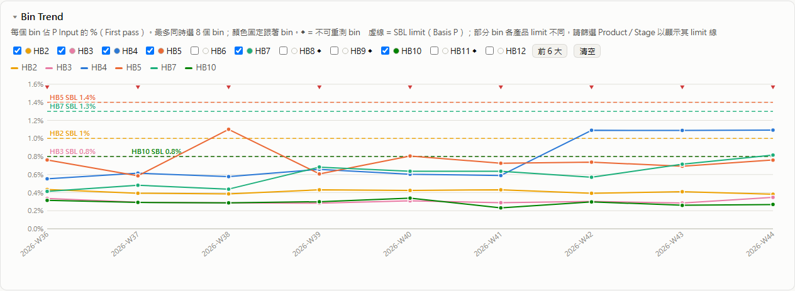
- Pick up to 8 bins. Each bin keeps its own colour.
- Own **time unit** and **chart** choice: **Line**, **Stacked bars** (total of the selected bins) or **Grouped bars**.
- **Compare by Product / Test Center**: each line = the selected bins combined for one product or test center (tick a single bin to see just that bin). Stacked bars are shown as grouped bars.
- Dashed lines = SBL limits. They are shown when every lot in the view uses the same limit; filter by Product / Stage to see product-specific limits.

### Pareto and heatmap
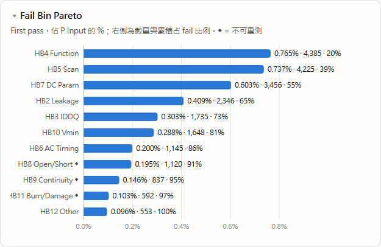
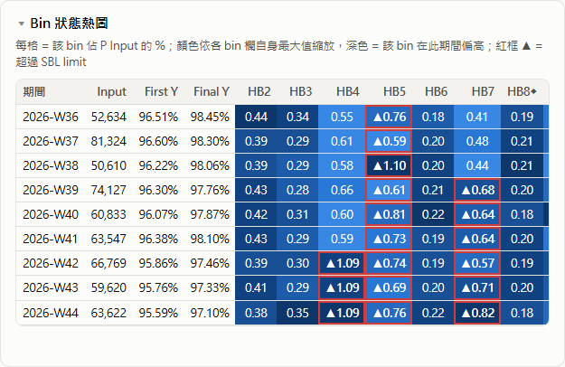
- Heatmap colour is scaled per bin column. A red border with ▲ = over the SBL limit.

### Tester / Loadboard / Test Center performance
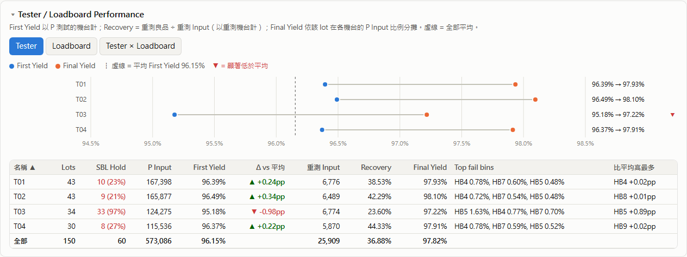
- Tabs: **Tester / Loadboard / Tester × Loadboard / Test Center / Product**.
- **First Yield** is counted on the tester that ran P. **Recovery** is counted on the tester that ran the retest.
- ▼ = First Yield significantly below average: more than 2σ (binomial) and more than 0.2 pp.
- **比平均高最多** = the bin that is most above the average on this tester. This is usually the root cause.

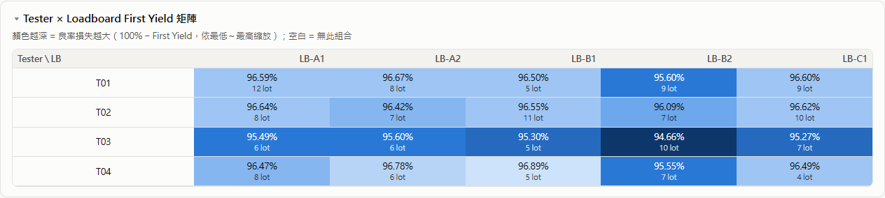

### Lot table and bin config
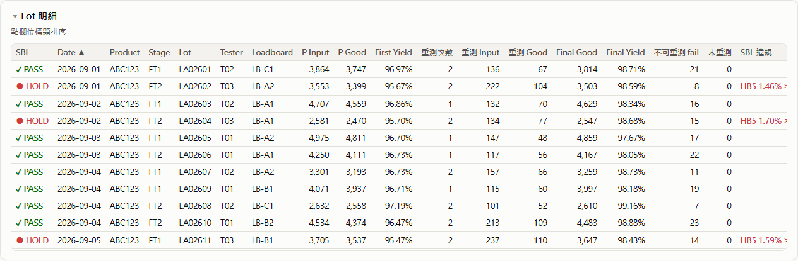
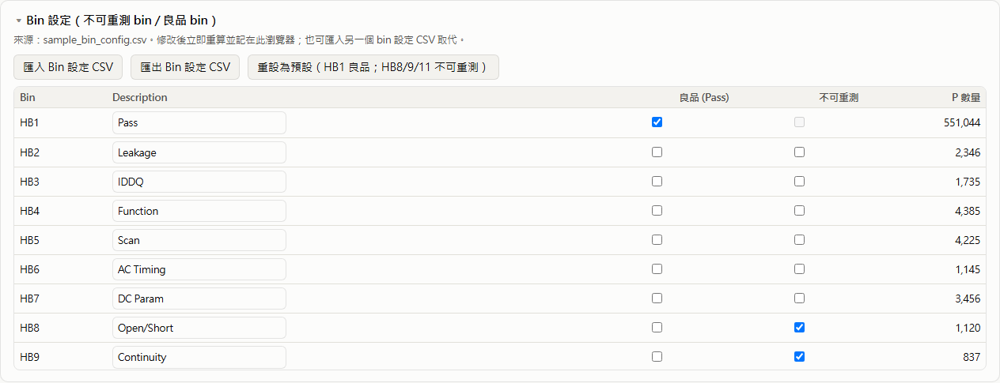

---

## 6. Big data

Measured in Chrome (headless) on this PC, with 32 bins per row:

| Lots | CSV rows | File size | Load | Filter change | Browser memory |
|---:|---:|---:|---:|---:|---:|
| 10,000 | 20 k | 2 MB | 2 s | 1 s | 40 MB |
| 50,000 | 98 k | 11 MB | 4 s | 1.5 s | 160 MB |
| 200,000 | 394 k | 46 MB | 13 s | 5 s | 620 MB |
| 500,000 | 986 k | 114 MB | 44 s | 20 s | 1.6 GB |

- **Comfortable** up to about **200,000 lots / 50 MB**. It still works at 1M rows, but slowly.
- Tables show the first 1,000 rows (sorted over all data), and the heatmap shows the latest 400 rows. **Export CSV** always contains everything.
- For very large histories, keep one folder per period (e.g. per quarter), or filter by date.

---

## 7. FAQ

**Q: The same lot has many O tests. Is that OK?**
Yes. See [4.3](#43-splitting-retest-o-rows-into-rounds). It works with date-only data, rows out of order, and retests split over several testers. Final Yield is always exact. If rounds can't be told apart (date only, no round numbers, and a partial retest), only the final bin split may be slightly off. Writing `O1`, `O2` … or adding a time avoids this.

**Q: Which bins are "good"?**
HB1 by default. Mark other bins as Pass in **Bin 設定** or in the bin config CSV.

**Q: What is bin `NR`?**
Units that failed with a retestable bin but were never retested (P fails minus the units that went into the retest).

**Q: What does "◐ 待重測" mean?**
The lot only breaks a `Final`-basis limit and has not been retested yet. A retest may still change the result, so it is not counted as HOLD.

**Q: Do I need internet?**
No. `test_summary_trend.html` uses no external files, and its built-in help page draws the flowcharts itself. Only the optional `flowchart.html` loads Mermaid from the internet.

**Q: Which browser?**
Chrome or Edge. Folder reading (📁) needs one of them. Opening files and drag & drop also work in Firefox.

---

_Last updated: 2026-11-02_
